

<picture><source media="(prefers-color-scheme: dark)" srcset="assets/hero-dark.svg"></picture>
  
<a href="https://github.com/yappologistic?tab=repositories&q=&type=source"><picture><source media="(prefers-color-scheme: dark)" srcset="assets/btn-projects-dark.svg"></picture></a>&nbsp;<a href="https://buymeacoffee.com/e_gurl"><picture><source media="(prefers-color-scheme: dark)" srcset="assets/btn-coffee-dark.svg"></picture></a>
   
<picture><source media="(prefers-color-scheme: dark)" srcset="assets/h-featured-dark.svg"></picture>

<a href="https://github.com/yappologistic/Spun"><picture><source media="(prefers-color-scheme: dark)" srcset="https://raw.githubusercontent.com/yappologistic/yappologistic/output/card-Spun-dark.svg"></picture></a>&nbsp;<a href="https://github.com/yappologistic/Sung"><picture><source media="(prefers-color-scheme: dark)" srcset="https://raw.githubusercontent.com/yappologistic/yappologistic/output/card-Sung-dark.svg"></picture></a>

<a href="https://github.com/yappologistic/CUI"><picture><source media="(prefers-color-scheme: dark)" srcset="https://raw.githubusercontent.com/yappologistic/yappologistic/output/card-CUI-dark.svg"></picture></a>&nbsp;<a href="https://github.com/yappologistic/Maia"><picture><source media="(prefers-color-scheme: dark)" srcset="https://raw.githubusercontent.com/yappologistic/yappologistic/output/card-Maia-dark.svg"></picture></a>

<a href="https://github.com/yappologistic/Cohort"><picture><source media="(prefers-color-scheme: dark)" srcset="https://raw.githubusercontent.com/yappologistic/yappologistic/output/card-Cohort-dark.svg"></picture></a>&nbsp;<a href="https://github.com/yappologistic/Ava"><picture><source media="(prefers-color-scheme: dark)" srcset="https://raw.githubusercontent.com/yappologistic/yappologistic/output/card-Ava-dark.svg"></picture></a>

  
<picture><source media="(prefers-color-scheme: dark)" srcset="assets/h-more-dark.svg"></picture>

<a href="https://github.com/yappologistic/Nala"><picture><source media="(prefers-color-scheme: dark)" srcset="https://raw.githubusercontent.com/yappologistic/yappologistic/output/mini-Nala-dark.svg"></picture></a>&nbsp;<a href="https://github.com/yappologistic/Orbit"><picture><source media="(prefers-color-scheme: dark)" srcset="https://raw.githubusercontent.com/yappologistic/yappologistic/output/mini-Orbit-dark.svg"></picture></a>

<a href="https://github.com/yappologistic/Wineel"><picture><source media="(prefers-color-scheme: dark)" srcset="https://raw.githubusercontent.com/yappologistic/yappologistic/output/mini-Wineel-dark.svg"></picture></a>&nbsp;<a href="https://github.com/yappologistic/winotch"><picture><source media="(prefers-color-scheme: dark)" srcset="https://raw.githubusercontent.com/yappologistic/yappologistic/output/mini-winotch-dark.svg"></picture></a>

<a href="https://github.com/yappologistic/FACT3"><picture><source media="(prefers-color-scheme: dark)" srcset="https://raw.githubusercontent.com/yappologistic/yappologistic/output/mini-FACT3-dark.svg"></picture></a>&nbsp;<a href="https://github.com/yappologistic/Sprinkle-CLI"><picture><source media="(prefers-color-scheme: dark)" srcset="https://raw.githubusercontent.com/yappologistic/yappologistic/output/mini-Sprinkle-CLI-dark.svg"></picture></a>

<a href="https://github.com/yappologistic/focus-friendly"><picture><source media="(prefers-color-scheme: dark)" srcset="https://raw.githubusercontent.com/yappologistic/yappologistic/output/mini-focus-friendly-dark.svg"></picture></a>&nbsp;<a href="https://github.com/yappologistic/Unmuze"><picture><source media="(prefers-color-scheme: dark)" srcset="https://raw.githubusercontent.com/yappologistic/yappologistic/output/mini-Unmuze-dark.svg"></picture></a>

<a href="https://github.com/yappologistic/e-gurl-community-cpp-qt-qml-roadmap"><picture><source media="(prefers-color-scheme: dark)" srcset="https://raw.githubusercontent.com/yappologistic/yappologistic/output/mini-e-gurl-community-cpp-qt-qml-roadmap-dark.svg"></picture></a>&nbsp;<a href="https://github.com/yappologistic/CSharp-Tutor"><picture><source media="(prefers-color-scheme: dark)" srcset="https://raw.githubusercontent.com/yappologistic/yappologistic/output/mini-CSharp-Tutor-dark.svg"></picture></a>

  
<picture><source media="(prefers-color-scheme: dark)" srcset="assets/h-toolbox-dark.svg"></picture>
 
<picture><source media="(prefers-color-scheme: dark)" srcset="assets/toolbox-dark.svg"></picture>
   
<picture><source media="(prefers-color-scheme: dark)" srcset="assets/h-activity-dark.svg"></picture>
 
<picture><source media="(prefers-color-scheme: dark)" srcset="https://raw.githubusercontent.com/yappologistic/yappologistic/output/stats-dark.svg"></picture>
  
<picture><source media="(prefers-color-scheme: dark)" srcset="https://raw.githubusercontent.com/yappologistic/yappologistic/output/snake-dark.svg"></picture>
   
<picture><source media="(prefers-color-scheme: dark)" srcset="assets/footer-dark.svg"></picture>

